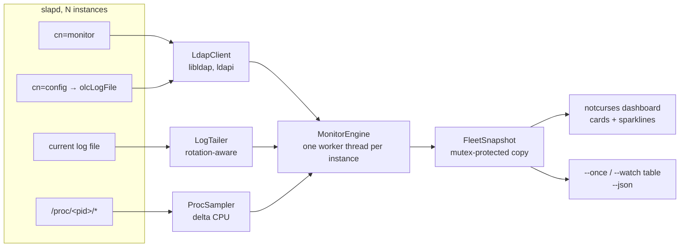

# slaptop

Real-time terminal dashboard for one or more OpenLDAP `slapd` instances.
Built in C++20 on top of [notcurses](https://github.com/dankamongmen/notcurses),
in the spirit of `htop` and `btop`.

## What it shows

| Signal | Source |
|---|---|
| Existence, thread count, CPU %, RSS, VSZ | `/proc/<pid>/{stat,statm,status}` |
| Connections, operations per type, listeners, databases | `cn=monitor` over the instance's `ldapi://` socket |
| Replication lag | `contextCSN` of each replicated naming context |
| Log volume and errors | `olcLogFile` (read from `cn=config`, or from `<slapd -F dir>/cn=config.ldif`) |
| Resource hogs: etime per account and per filter family | the same log, `SRCH` paired with `RESULT` over a sliding window |



## Versioning and stability

`slaptop` follows [Semantic Versioning](https://semver.org). `0.7.0` is the
first public release and stays pre-1.0: the tool already runs a real fleet, and
the items below are what `1.0.0` will freeze.

From `0.7.0` on, these are **stable**: a change is either additive, or it comes
with a migration note in [CHANGELOG.md](CHANGELOG.md).

* every key accepted by the configuration file, as documented in
  [`docs/slaptop.conf.example`](docs/slaptop.conf.example), node specification
  options (`key=`, `port=`, `name=`, `instances=`, `compress=`, …) included;
* the `[group <name>]` and `[theme <name>]` sections;
* every command-line option listed by `--help`;
* the JSON field names produced by `--json` and `--jsonl`.

`--version` prints the version **and the commit the binary was built from**
(`unknown` for a source tarball), so a bug report can be tied to a revision,
and `--doc` / `--license` print the documentation and the licence this binary
was built with.

## Design constraints that shaped the code

* **One worker thread per instance.** A proxy backend can block `cn=monitor`
  for seconds. A single collection loop would freeze the whole dashboard;
  per-instance workers degrade one card instead.
* **No blocking read in the UI.** The dashboard only copies a mutex-protected
  `FleetSnapshot` every 100 ms, so rendering never waits on LDAP or disk.
* **`contextCSN` is polled slowly.** Querying it on an empty naming context
  returns `err=32`, which pollutes the monitored server's own log. Results are
  cached and re-queried every 5 s (success) or 60 s (failure).
* **Conservative C++20.** GCC 11 is the oldest supported compiler, so
  `std::format` and most of `<ranges>` are unavailable. `std::jthread`,
  concepts, structured bindings and `<optional>` are fine.
* **notcurses 3.0 C API.** The distribution packages (3.0.14/3.0.17) ship only
  the C headers (`notcurses.h`), without `notcurses.hh` or `ncplot.h`. Frames,
  cards and sparklines are drawn with runes from the C API.

## Server cost

Reading `/proc/<pid>/stat` deltas over 18 s, on an idle fleet:

| Configuration | Compiled slapd CPU |
|---|---|
| no monitoring | 0 % |
| `--interval 0.5`, `cn=monitor` every tick | **3-5 %** per instance |
| `--interval 0.5`, `--ldap-interval 2` (default) | **0-1 %** per instance |

`cn=monitor` returns ~87 entries, and that listing dominates the cost: six
narrow searches cost *more* than one subtree search (0.58 s vs 0.35 s for 20
iterations). The fix is therefore cadence, not scope: process metrics stay at
`--interval`, LDAP counters at `--ldap-interval`.

## Build

A `Makefile` wraps the everyday commands; CMake remains the real build.

```sh
make            # configure + build (Debug)
make release    # optimized build in build-release/
make test       # build + unit tests
make run        # build + dashboard
make once       # build + one text snapshot
make static     # portable binary (scripts/build-static.sh)
make bump       # next version inferred from the commits since the last one
make bump-apply # write it into CMakeLists.txt (single source of the version)
make install PREFIX=~/.local
make clean
```

### Local (Fedora/Bazzite, Homebrew)

```sh
brew install notcurses
export PKG_CONFIG_PATH=/home/linuxbrew/.linuxbrew/lib/pkgconfig:$PKG_CONFIG_PATH
cmake -S . -B build -G Ninja \
      -DSLAPTOP_WITH_TUI=ON -DSLAPTOP_WITH_LDAP=ON
cmake --build build
ctest --test-dir build --output-on-failure
```

### Target host (OpenLDAP out of tree)

```sh
cmake -S . -B build \
      -DSLAPTOP_WITH_TUI=ON -DSLAPTOP_WITH_LDAP=ON \
      -DSLAPTOP_LDAP_ROOT=/path/to/openldap-2.6 \
      -DSLAPTOP_LDAP_LIBDIR=/opt/openldap/lib
cmake --build build -j4
```

`SLAPTOP_LDAP_ROOT` supplies `ldap.h`; `SLAPTOP_LDAP_LIBDIR` supplies
`libldap.so.2` (that runtime ships only the versioned `.so`). The binary gets an
`RPATH` on that directory.

## Requirements: what makes the full view possible

slaptop reads four sources per instance. Each one has its own prerequisite, and
a missing one costs a slice of the screen — never the whole tool.

| Source | What it gives | What it needs |
|---|---|---|
| `/proc/<pid>` | CPU, RSS, threads, file descriptors, ephemeral ports, `/proc/net/*`, `/proc/diskstats` | permission to read the process (same uid as slapd, or root) |
| `cn=monitor` | operations, connections, databases, replication lag | **`ldapi://`** + SASL EXTERNAL, or a bind DN with read access |
| `cn=config` | architecture, overlays, chain targets, log path | **`ldapi://`** + EXTERNAL (it is normally unreadable otherwise); falls back to the on-disk `slapd.d` |
| the log file | Behaviour, binds per connection, errors | read access to `olcLogFile` |

Without `ldapi://` the dashboard still shows the process side (CPU, memory,
I/O), but operations, databases, connections and replication stay empty and a
`no ldapi listener` status replaces them.

### 1. `ldapi://` must be enabled

The Unix socket is what makes the last two rows of that table possible: slapd
identifies the caller by the socket's peer credentials (`SO_PEERCRED`), so
EXTERNAL authentication needs no password and no TLS, and grants `cn=config`
access that a TCP anonymous bind never gets.

```sh
# command line (the socket path is percent-encoded in the URI)
slapd -h "ldapi://%2Fvar%2Frun%2Fopenldap%2Fldapi ldap:/// ldaps:///" -F /etc/openldap/slapd.d
```

Distribution service files:

* Debian/Ubuntu — `/etc/default/slapd`:
  `SLAPD_SERVICES="ldapi:/// ldap:///"`
* Fedora/RHEL — `/etc/sysconfig/slapd`: `SLAPD_URLS="ldapi:/// ldap:///"`
* systemd unit — `ExecStart=... -h "ldapi:/// ldap:///"`

Several instances on one host need one socket each, usually named after the
instance: `-h "ldapi://%2Frun%2Fslapd_proxy%2Fldapi ldaps://:1636/"`. slaptop
reads the socket path from the process command line (`-h`), so nothing has to be
declared in its configuration.

### 2. The Unix user must be the one running slapd

EXTERNAL maps the peer to a pseudo-DN built from its uid and gid:

```
gidNumber=1000+uidNumber=1000,cn=peercred,cn=external,cn=auth
```

slapd's default `cn=config` ACL grants that identity `manage` only for
`uidNumber=0` and for the user slapd itself runs as. Two ways to comply:

* **simplest** — run slaptop as the slapd user (or as root):
  `sudo -u ldap slaptop`, or `ssh slapdhost slaptop` when that account is the
  one you land on;
* **least privilege** — keep a dedicated account and give it its own read
  access. Run slaptop as `monitoring` (uid 1000) and map the peer credential to
  a DN you can grant:

  ```ldif
  dn: cn=config
  changetype: modify
  add: olcAuthzRegexp
  olcAuthzRegexp: {0}"gidNumber=1000\+uidNumber=1000,cn=peercred,cn=external,cn=auth" "cn=monitoring,ou=services,dc=example,dc=org"

  dn: olcDatabase={0}config,cn=config
  changetype: modify
  add: olcAccess
  olcAccess: {0}to * by dn.exact="cn=monitoring,ou=services,dc=example,dc=org" read by * none
  ```

  `cn=monitor` is world-readable once the connection is authenticated at all, so
  only `cn=config` needs an explicit rule. Apply with
  `ldapmodify -Y EXTERNAL -H ldapi:/// -f monitoring.ldif`.

Both accounts also need to read the slapd log (`olcLogFile`, typically
`/var/log/slapd/slapd.log`, mode 0640 owned by `ldap`): add the monitoring user
to the `ldap` group rather than widening the file mode.

`slaptop --diagnose` reports, per instance, whether those three checks pass and
what to change when they do not.

### 3. SSH access for remote nodes

Monitoring a host over SSH (`node = ...`) needs an account that can read the
same things remotely, and a key that works without a prompt.

```sh
# once per monitoring account, per node
ssh-keygen -t ed25519 -f ~/.ssh/slaptop -N ''
ssh-copy-id -i ~/.ssh/slaptop.pub ldap@ldap1
```

* **Non-interactive**: slaptop runs `ssh -o BatchMode=yes`, so a passphrase
  prompt, a `PasswordAuthentication` fallback or an unknown host key all fail
  at once. Pre-accept the key with `ssh-keyscan` (or
  `StrictHostKeyChecking accept-new`) before the first run.
* **`~/.ssh/config` is read**: `Host` aliases, `HostName`, `User` and
  `ProxyJump` apply as they are — a DMZ host reached through a bastion needs no
  option in slaptop's own configuration.
* **The remote account must read** `/proc/<pid>` of slapd (same uid, or root),
  the `slapd.d` tree (it is tarred as-is), the log file and the `ldapi` socket.
* **Stream local forwarding must stay enabled** (ssh's `AllowStreamLocalForwarding`,
  on by default): that is how the `ldapi://` socket travels over the SSH
  connection. `DisableForwarding yes`, `ForceCommand` or `Restrict` would leave
  the card with CPU and memory only — and say so.
* **The commands used remotely** are `ps`, `cat`, `ls`, `wc`, `tar`, `stat`,
  `df`, `getconf`, `head`, `tail`, `grep`, `tr`: a restricted shell or an
  `rbash` without them breaks collection.
* **The session is shared**: one `ControlMaster` per node
  (`ControlPath` under `XDG_RUNTIME_DIR`, `ControlPersist=300 s`) carries every
  call and the socket forward, so the account authenticates once per five
  minutes, not once per round.

A host declared both locally and as a node is detected and counted once: the
host name is resolved at startup (through `ssh -G`, so `ssh_config` aliases are
understood) and compared with this machine's addresses.

## Usage

```sh
slaptop                      # dashboard (when stdout is a tty)
slaptop --once               # one text snapshot
slaptop --json --once        # machine-readable snapshot
slaptop --watch 2            # plain-text refresh loop
slaptop --watch 1 --duration 60   # bounded capture
slaptop --interval 0.5       # faster /proc collection
slaptop --ldap-interval 5    # cheaper cn=monitor collection
slaptop --ldap ldapi://%2F...%2Fldapi-proxy   # dump cn=monitor for one URI
slaptop --uri ldaps://ldap1:636 --insecure # remote instance (no /proc data)
slaptop --uri-file servers.txt --insecure  # several remote instances
slaptop --jsonl --watch 1      # one JSON object per instance per line
slaptop --bind EXTERNAL --ldap ldapi://... # SASL peer credentials
slaptop --probe-pixels       # what this terminal can draw (sixel/kitty/none)
slaptop --diagnose           # why a card would be incomplete, with the fix
```

The graphs are drawn as pixels when the terminal supports it, as block runes
otherwise; both carry the same axis. The bitmap labels use one fixed size on
every graph — a short graph shows fewer of them rather than smaller type.
`SLAPTOP_PIXEL_DUMP=/path/graph.ppm` writes each bitmap (a PPM image) before it
is blitted — the file keeps the last graph drawn, so the pixel rendering can be
inspected from a terminal that advertises no pixel protocol: a plain `tmux`
session, an ssh hop, or a CI run.

`--diagnose` walks the same sources the dashboard uses — `/proc`, `ldapi://`,
EXTERNAL, `cn=monitor`, `cn=config`, the log file, then the SSH transport that
carries them — and prints one line per check, with the configuration change to
make when one fails. It exits `1` when a check that leaves the tool blind fails:

```
  node ldap1.example.com (config ~/.config/slaptop/config [group lab])
  ok    ssh transport                      reaches ldap1.example.com
  ok    slapd instances discovered         3 instance(s)

  instance replica1 (pid 988198, node ldap1.example.com)
  ok    ldapi:// listener                  ldapi://%2Frun%2Fslapd_replica%2Fldapi
  ok    ldap over ldapi (EXTERNAL)         bind ok (...cn=peercred,cn=external,cn=auth)
  ok    cn=monitor                         32 entries, 4 databases
  warn  cn=config                          not readable
       -> cn=config is granted to the slapd user and to uid 0; run slaptop as
          that user, or add an olcAuthzRegexp mapping with read access
```

A `warn` means a slice of the screen will stay empty (the run continues, and
says so); `FAIL` means nothing comes from that host at all.

Dashboard keys, meant to be tapped once rather than held:

| Key | Action |
|---|---|
| `Tab` | next instance (cycles; the active tab is bracketed in the header) |
| `1`..`9` | jump straight to an instance |
| `Enter` | Connections: open/close the live log of the selected connection |
| `Esc` | back: closes the current screen, then quits |
| `s` / `f` | Connections: cycle the sort key / hide entries without a bind DN |
| `↑` / `↓` | Connections: move the selection; Monitor: scroll the table |
| `←` / `→` | previous / next instance (on Monitor: the other server's `cn=monitor`) |
| `t` | architecture view: roles, path diagram, links |
| `p` | pause the display (collection continues) |
| `g` | graphs: automatic scale ↔ relative to the machine (100 % of its cores, its whole RAM) |
| `+` / `-` | collection interval |
| `?` | key reference |
| `q` | quit |

The instance tabs in the header are `[proxy] provider replica`: the selected one is boxed,
highlighted and underlined, so the current screen is always obvious.
`Ctrl-C` is handled so the terminal is always restored.

The dashboard card gathers what the retired detail screen used to add:
connection totals, operations per type, databases with their suffixes and
overlays, listeners, the busiest connections, and the last log errors. The
`Monitor` tab keeps the raw tree for anything the card does not derive, and
the `Databases` and `Connections` tabs cover their subtrees in full.

Exit codes: `0` normal, `1` LDAP dump failure, `2` bad usage or no terminal.

### Display modes

* **Cards** — one block per instance, with one to three stacked area graphs
  sharing a single time axis:
  * `cpu` (sea green → amber → red),
  * `mem` (blue → violet),
  * `ops` (deep green → gold).

  Because they are vertically aligned, a load spike, a memory jump and an
  operation burst line up: correlation is read by eye, not computed. Each cell
  holds 8 vertical levels, so a 2-row graph resolves 16 steps, and the colour
  runs along the vertical axis (dark at the baseline, bright at the top).
  The number of bands adapts to the space: three with room, one on a short
  terminal.

  A dotted grid marks the quarter, half and three-quarter lines of the band,
  and it is drawn *before* the area so it only shows where there is no data:
  enough to read a height, never enough to fight with the curve.

  `g` switches the scale. Automatic fits the data (a quiet server still shows
  its shape); relative draws against what the machine can give — `0% / 100%`
  for CPU (the graph is already machine-relative) and `611M / 31.1G` for
  memory — which is what says whether the graph is *high* or merely *higher
  than before*. Activity has no natural maximum and keeps its automatic
  scale.

* **No log panel on the dashboard** — a tail at collector speed is unreadable
  on a busy server: it scrolls faster than it can be read, and half of it was
  slaptop's own monitoring traffic. The `Logs` tab is the place to read it.

* **A tail that is always full** — the panel keeps its last lines instead of
  expiring them by age, and the text is anchored at the bottom: new lines
  appear at the same place, and a quiet server keeps showing its last activity
  rather than an empty box. Only the **oldest three to five lines on screen**
  fade, by position and not by age (one fifth of the panel, bounded to 3-5),
  which marks where the tail starts and dims nothing that was just printed.
  The `log-ttl` / `log-fade` keys are retired: they are still accepted so an
  existing configuration does not warn, but nothing reads them.

* **Fleet status in the header** — one dot per instance next to the clock:
  green when the server answers, amber when the process runs but `cn=monitor`
  does not answer, red when the process is gone (the card stays, marked
  `stopped`). The name follows the dot in the same colour.

* **Tabs** — the header lists one tab per screen; `Tab` cycles through them
  (one keystroke each, nothing to hold):

  | Tab | Content |
  |---|---|
  | `Dashboard` | cards: cpu/mem/ops graphs and two footer lines of counters |
  | `Architecture` | instance boxes with cpu/mem/ops side by side, the client → data path diagram, and the declared links |
  | `Databases` | everything `cn=monitor` exposes per database: overlays, MDB pages/readers/entries, naming contexts, a pie of the LMDB pages (data vs freelist, with `data/free/map` in the legend) and, for pcache, the hit ratio |
  | `I/O` | the network interfaces slapd listens on and **every LMDB directory**: one per naming context (`olmDbDirectory`), the pcache cache database declared under its overlay, and the log directory; throughput, io_ticks busy share, free space, and a receive/transmit (or read/write) sparkline under each row |
  | `Replication` | shown only when an instance publishes a `contextCSN`: per-SID last write, when it last moved, worst lag seen, the instance × SID matrix (sync'd / behind / ahead) and the per-operation counters |
  | `Connections` | live connections (capped at 40, list refreshed every 30 s), newest bind first; `s` cycles the sort key (newest, busiest, I/O, bind DN), `f` hides entries without a bind DN, `Enter` opens that connection's live log under the list |
  | `Monitor` | every collected `cn=monitor` entry, laid out in newspaper columns (one to four depending on the width) with vertical scrolling only when it does not fit; `←`/`→` shows another instance's tree — catches what a derived product (lloadd tiers, custom overlays) publishes |
  | `Logs` | full-screen tail of the selected instance, colourised field by field |

* **Connection inspection** — the list shows the connection number, its
  **bind DN** (from `monitorConnectionAuthzDN`, falling back to the `BIND dn=`
  line of the log), completed and pending operations, and socket I/O. `Enter`
  opens **the live log of the selected connection** in a frame under the list:
  it follows the selection as you move, and every line is colourised. Above
  the log, one line of identity (peer, protocol, listener, mask, last
  activity) keeps the panel useful when the connection logged nothing.

* **Two LMDB pies** — one number cannot say both things an administrator needs,
  so each database box carries two, and the colours differ:
  * **`fragmentation %`** (left) is the share of the file sitting in the
    freelist: `pagesFree / pagesUsed`. Free pages are reusable but never given
    back to the filesystem, which is why a 40 GB sparse file can hold 180 MB of
    data and still show a large file. The pie fills with the freelist, so an
    empty pie means a compact file; it turns amber past 25 %, which is a
    maintenance signal (an `mdb_copy` would shrink the file), not an emergency.
  * **`map used %`** (right) is the share of the map the file occupies:
    `pagesUsed / pagesMax` — the very ratio `assessLmdb()` alerts on. It turns
    amber at `kMapWarningPercent` (75 %) and red at `kMapCriticalPercent`
    (90 %), because `MDB_MAP_FULL` is the moment this reaches 100 %. It is
    printed with one decimal below 10 %, since on a 19 TB map the difference
    between 0.4 % and 1.4 % is the whole story. Below 74 columns only this one
    is drawn: it is the one that predicts the failure.

    A separate `on disk` line gives the file's real occupation — allocated
    against apparent size — because a LMDB file is sparse: it can claim 40 GB
    and occupy 180 MB, and neither pie above says that.

  Both come from `cn=monitor`, not from the filesystem: `olmMDBPagesUsed` is
  `me_last_pgno+1` (the pages the file contains), `olmMDBPagesFree` is the
  freelist, `olmMDBPagesMax` is `me_mapsize / psize`. `olmMDBPageSize` is
  missing from some 2.6 builds, so the page size is derived from the file size
  when it is readable, and falls back to 4096. The legend under them keeps the
  absolute figures (`data`, `free`, `map`) so the percentages can be checked.

* **Map headroom alerts, before the failure** — `MDB_MAP_FULL` in the log is
  already too late: it means writes are failing. The signal slaptop watches is
  the room left in the map, sampled every round:

  | Condition | Severity |
  |---|---|
  | `pagesUsed/pagesMax` ≥ 90 %, or the forecast says "full in < 24 h" | **critical** — red, blinking |
  | ≥ 75 %, or "full in < 7 days" | warning — amber |
  | growth steeper than nothing but under the threshold | silent |

  The forecast is a slope, not a percentage: the per-database `pagesUsed`
  history (180 samples) gives pages per second, so a database at 40 % that
  fills in two hours is critical while one stable at 85 % is not. No estimate is
  shown before three minutes of observation — a made-up number would be worse
  than none.

  The alert carries the figure it was built from (`pages 47 776/9 765 625, free
  573, page 4096 B`) and a **suggestion**, never an action: the LDIF that would
  raise `olcDbMaxSize`, sized to +50 % and capped by the free space of the
  filesystem holding `olcDbDirectory`. slaptop does not apply it — it is a
  diagnostic aid, and the administrator decides. The blinking follows
  `[theme] animate`: with animations off the alert stays solid red, so no
  information is lost. `--json` exposes it under `alerts`.

* **pcache hit ratio** — `pcacheQueryURL` carries `x-answerable`, the number of
  times that cached query was served. The queries expire and are recreated
  under a new UUID, so slaptop tracks the counter per UUID and turns the
  increments into a hit count for the session, compared with the frontend
  search counter. The `Databases` tab shows the ratio, the gauges
  (`pcacheNumQueries`, `pcacheNumEntries`) and the three queries the cache
  serves most. Other overlays publish no counter in `cn=monitor`; their
  presence and order still show in the path diagram.

* **Space is shared, not fixed** — every screen fills the terminal: the free
  rows are distributed between the frames in proportion to what each has to
  show (a row of verbose databases grows more than a row of short ones). The
  dashboard divides its area exactly between the instances, and the monitor
  table and the log tail grow to the bottom edge.

  Note on filters: `monitorConnectionNumber` is operational and does **not**
  match in LDAP filters (1 result instead of N). The list is selected with
  `(cn=Connection*)` instead, and no RFC 2891 server-side sort is used —
  OpenLDAP answers "inappropriate matching" on those attributes, which made
  the whole search fail.

* **CPU on multi-core hosts** — a process can legitimately use 240 % (2.4
  cores). The dashboard shows both: `cpu 15.0% (2.4c)` is 15 % of the machine
  and 2.4 cores, and the graph scale is machine-relative so an 8-core server
  does not look saturated at 100 %.

* **Architecture view (`t`)** — one box per instance showing its role
  (`proxy`, `provider`, `consumer`, `+accesslog`), its **cpu, memory and
  activity graphs side by side** (three small multiples read better than one
  wide band) and its databases with their overlays.

  Under the boxes, a **path diagram** shows what a client actually traverses
  on the selected instance, every overlay included and in the order slapd
  applies them:

  ```
  client ─▶ ldap 0.0.0.0:1389 ─▶ ldaps 0.0.0.0:1636 ─▶ ldapi
         ─▶ pcache ─▶ sssvlv ─▶ sock
         ─▶ ldap dc=example,dc=com ─▶ ldaps://provider:2636
  ```

  Listeners, overlays, backend and storage all come from the instance's own
  `cn=config` tree; a proxy's storage node is the upstream URI, a database's
  is its MDB directory. A load balancer gets its own line per tier
  (`client ─▶ lload ─▶ tier 1 ─▶ backends`), and each database gets its own
  line — the `cn=accesslog` context is not mixed with the data context. Declared links are also drawn between the instance
  boxes (`──▶` proxy, `⇄` syncrepl), matched against the `cn=monitor`
  listeners of the other instances by port.

* **Several servers with their own credentials** — a remote target is a URI
  plus options, on `--uri` or one per line of `--uri-file`:

  ```
  # file: one target per line, # comments allowed
  ldaps://ldap1.example.com:636  bind="cn=monitor,ou=services,dc=example" \
                                 password-file=/home/user/.monitor-pw
  ldap://ldap2.example.com:389   starttls=yes bind="cn=monitor,…" \
                                 password-file=/home/user/.monitor-pw2
  ldap://192.0.2.1:389            name=lab insecure=yes
  ```

  | Option | Effect |
  |---|---|
  | `bind=DN` | this target's bind DN (falls back to `--bind`) |
  | `password-file=PATH` | read the password from a `0600` file (a warning is printed if it is group/world readable) |
  | `password=VALUE` | inline password, for a throw-away test only |
  | `starttls=yes` | upgrade `ldap://` with StartTLS before binding |
  | `insecure=yes` | accept a self-signed certificate for this target only |
  | `name=LABEL` | display name instead of `host:port` |

  An unknown key is a hard error: a typo must not silently fall back to the
  global credentials and fail against one server only.

  The password comes from, in order: `--bind-password-file`, the
  `SLAPTOP_BIND_PW` environment variable, then `password-file` in the
  configuration.  A password on the command line is deliberately not
  supported — it would be visible in `ps`.

* **Remote hosts over SSH, as if they were local** — `--node` (or `node-file`)
  monitors the instances of a host reached by SSH with a key, with **every**
  source of a local run:

  ```
  # ~/.config/slaptop/nodes, one node per line, four at most
  user@ldap1.example.com            name=lab
  user@ldap2.example.com key=~/.ssh/lab port=2222 instances=proxy,provider
  ```

  | Source | How it travels |
  |---|---|
  | `/proc/<pid>/*` (CPU, RSS, threads) | one batched `cat` per node per round |
  | the log file | one polling `tail` per instance, rotation-aware |
  | `slapd.d` (architecture, databases, log path) | `tar` of the `-F` tree, mirrored once every five minutes |
  | `cn=monitor` | the instance's **`ldapi` socket, forwarded over SSH** |

  The forwarded Unix socket is the trick that removes credentials entirely:
  slapd sees the connection coming from the SSH user, so `peercred`/`EXTERNAL`
  works exactly as it does on the host itself. One authenticated connection per
  node (ControlMaster, five-minute persistence) carries every call afterwards;
  the same four-node limit applies after merging the file and the command line.
  A node that stops answering degrades its own cards; the others keep running.

* **ldaprc files are reported** — libldap reads `$LDAPRC`, `./ldaprc`,
  `./.ldaprc`, `$HOME/ldaprc` and `$HOME/.ldaprc` by itself when the
  connection opens.  slaptop prints what it found and which keys each file
  sets (`reading /home/user/.ldaprc (TLS_CACERT, SASL_MECH)`), because that is
  the classic explanation for a bind the command line does not account for;
  `LDAPNOINIT=1` disables them and is reported too.  The same summary is in
  `--jsonl` under `connection` and on the `?` help screen.

* **Documentation and licence in the binary** — `--doc` prints the README and
  `--license` the AGPL v3 text, both embedded at build time from the files
  themselves (`scripts/gen_embedded.py`, `make doc`, `make check-doc` fails
  when `src/embedded.cpp` is stale).

* **Replication view** — the same reading as OpenLDAP's `slapd-watcher`, but
  rebuilt from what the servers publish rather than from a command line:

  | `slapd-watcher` | slaptop |
  |---|---|
  | `-s 1,2` SID → URL mapping | `olcServerID` values read from each instance's `cn=config`, matched to the other instances by host name, then by listening port |
  | `contextCSN` per SID | the `contextCSN` of the naming context, one row per SID |
  | `actv@` / `idle@` | the last time the CSN value moved while slaptop watched, and the worst lag it has seen (`max lag`) |
  | `sync'd` / `ahead` / `behind` | one matrix cell per instance and SID, compared to the SID owner (or to the most advanced server when no owner is declared) |
  | `Num` / `Num/s` per operation | the `monitorOpCompleted` counters of `cn=Operations` and the rate computed between two rounds |
  | entries | `olmMDBEntries` of the database holding that naming context |

  A SID is only compared inside the replica set that an `olcSyncRepl` actually
  links: two pairs that never exchange updates each keep the other pair's SID
  as a year-old leftover of a shared import, and calling that "behind 340 days"
  would be an alarm nobody can clear. Those cells read `—`, with the reason on
  the last line of the box.

  The tab only exists when at least one instance has a `contextCSN`, so a
  fleet of pure proxies keeps one tab fewer. Nothing is queried beyond what the
  dashboard already collects: the SID map comes from the configuration, the
  timestamps from the CSNs themselves.

* **Behaviour view** — the resource-hog analysis, in real time, computed from
  the access log slaptop already tails. Every `SRCH` line is paired with its
  `RESULT` line on `(conn, op)` and folded into a **60 s sliding window** of
  one-second slices:

  | Section | What it answers |
  |---|---|
  | verdict | which account spends the window's `etime` on a filter that cannot use an index (substring, negation), above 20 % of the total |
  | cost by account | operations, total `etime`, average per operation and share; top 10 by total |
  | filter families | the `(account, family)` pairs, slowest first, `⚠` on the ones that force a scan |
  | sparklines | searches per second and `etime` per second on one time axis, so a burst and its price line up vertically |

  A filter is generalized exactly as slaplog does it — `(uid=user123)` becomes
  `(uid=$#)`, `(|(uid=a)(uid=b)(uid=c))` becomes `(|(uid=$)+)` — so a family
  has the same name in both tools. A family is **slow** when it carries a
  negation or a wildcard that is not a plain presence test: `(uid=*)` is
  indexed, `(cn=*foo*)` is not.

  A verdict needs evidence: 100 searches **or** 500 ms of accumulated server
  time in the window, and a family with either 10 completed searches or 100 ms
  on its own — otherwise one lucky query would be 100 % of a tiny sample and a
  quiet lab would accuse everyone. The collector ranks every account and keeps
  the **first 100** rows; the screen draws as many as fit, so a tall terminal
  is never half empty and a short one shows `… N more`. The ranking is always
  computed over every key: the share moves as slices expire, so truncating the
  candidates would hide the hog that is climbing. Accounts past 512 distinct bind DNs fold into `(other)` rather
  than evicting a real one.

  This is the only way to see `etime` and the filter: `cn=monitor` publishes
  counters, not durations. It needs `olcLogLevel` to include `stats` (256) and
  an `olcLogFile`; slaptop says which one is missing instead of showing an
  empty table. On a remote instance (`--uri`) there is no log, so the tab is
  not offered. The window starts at the current end of the file, and the
  traffic slaptop generates itself is excluded like everywhere else.
  `--json` carries the same data under `behavior` (`hogs`, `accounts`,
  `families`).

* **No separate detail screen** — the card already carries the whole instance:
  header (cpu, memory, threads, ops/s, connections, lag), three graphs, then
  two footer lines with the newest CSN, the log throughput and errors, the
  uptime, the listener and database counts, and the three busiest operation
  counters. A second screen would only repeat what the card shows.

* **Log colouring** — every line is parsed into fields and each field gets a
  colour from the OpenLDAP vocabulary (the same one `slaptrack` uses):
  timestamp and thread dim, `conn=`/`op=`/`fd=`/`tag=` cyan, `dn=`/`base=`
  green, `filter=`/`attr=` gold, `IP=`/`addr=` blue, `err=` green at 0 and red
  otherwise, `etime=`/`qtime=` getting amber past 100 ms and red past 1 s, and
  `BIND`/`SRCH`/`RESULT`/`ACCEPT` in the accent colours.

* **Own traffic is hidden** — slaptop polls `cn=monitor` every two seconds;
  those requests land in the log it displays. The first monitor search marks
  the connection, and every line of that connection is dropped until it
  closes, so the panel shows the traffic being monitored rather than the
  monitor itself.
* **A crashed instance stays on screen** — when a slapd process disappears,
  its card remains, turns red and reads `stopped`; the footer adds
  `1 stopped` next to the `2/3` fleet counter. The log tab keeps showing the
  last lines it captured (no fade), and the databases/monitor tabs keep the
  last `cn=monitor` answer, which is usually what you want to look at after a
  crash. If the instance is restarted it is matched on its `-F` directory and
  revived instead of duplicated.

* **Compact rows** — used when the cards cannot fit at all: one line per
  instance with a CPU sparkline. No instance is silently hidden.
* **Too small** — below 24x5 columns the dashboard prints a hint.

### Single-file build (notcurses embedded)

By default the binary links `libnotcurses.so.3` and needs the notcurses package
installed. `SLAPTOP_STATIC_NOTCURSES=ON` embeds `libnotcurses-core.a` instead,
and no notcurses runtime is required anymore:

```sh
# target host (needs the static archive: dnf install notcurses-static)
cmake -S . -B build-static -DCMAKE_BUILD_TYPE=Release \
      -DSLAPTOP_WITH_LDAP=ON -DSLAPTOP_WITH_TUI=ON \
      -DSLAPTOP_STATIC_NOTCURSES=ON \
      -DSLAPTOP_LDAP_ROOT=/path/to/openldap-2.6 \
      -DSLAPTOP_LDAP_LIBDIR=/opt/openldap/lib
cmake --build build-static -j4
```

`ldd` then shows **no notcurses**: the TUI needs nothing but the base system
libraries and libldap.

Why `libnotcurses-core.a` and not `libnotcurses.a`: the "full" library adds the
multimedia decoders (ffmpeg, OIIO) that a dashboard never uses. The core
exports `notcurses_core_init`, which is what the code calls. Linking the full
archive would pull ffmpeg in.

What remains dynamic, and why it is not worth chasing:

| Library | Why | Available on any el9/Fedora host |
|---|---|---|
| `libtinfo.so.6` / `libncursesw.so.6` | terminfo lookups only (5 symbols: `setupterm`, `tigetstr`, `tigetnum`, `tigetflag`, `del_curterm`) — notcurses emits its own ANSI | yes (ncurses-base) |
| `libgpm.so.2` | console mouse support compiled into the distro notcurses build | yes |
| `libunistring.so.2`, `libdeflate.so.0` | Unicode width, Kitty blitter compression | yes |
| `libldap.so.2`, `liblber.so.2` | `cn=monitor` client, from the same OpenLDAP build | present wherever slapd runs |

A fully static binary is possible on a host that ships the matching `.a`
archives: add `-DSLAPTOP_STATIC_DEPS=ON`. Fedora's notcurses bottle (brew) has
`libunistring.a`, `libncursesw.a` and `libdeflate.a`, so the local build drops
to a single 847 KB file plus the C/C++ runtime. RHEL/el9 does not ship those
static archives, so the target keeps them dynamic; and `libldap` has no static
archive in that tree at all (only `libldap.so.2`).

### Portable binary (every feature kept)

`scripts/build-static.sh` produces the build verified against a production
slapd on RHEL 9.8: **855 KB**, no missing library, SASL EXTERNAL and TLS
working. Nothing is installed on a production host: the binary is built and
tested on a development machine, then copied to the hosts that are allowed to
receive it, and only after the tests are green.

The rule is "link statically only what the target lacks":

| Dependency | Target has it? | Decision |
|---|---|---|
| `libdeflate.so.0` | **no** (RHEL 9) | compiled here, linked statically |
| `libunistring.so.2` | yes, but version-specific | linked statically (defensive) |
| `libtinfo`, `libz`, `libgpm` | yes | dynamic |
| `libldap.so.2`, `liblber`, `libsasl2`, `libssl` | yes (openldap-compat provides the soname) | dynamic — this is what keeps **SASL EXTERNAL** and `ldaps://` |

Linking OpenLDAP statically would have meant rebuilding it without cyrus-sasl
(the distro ships no `libsasl2.a`), silently losing a feature. Since RHEL 9
provides `libldap.so.2`, the dynamic link is the better trade.

Verified on a RHEL 9 host (glibc 2.34) against a production instance: `1 inst · conn 2/62330 · ops 5.5/s · csn 2026-11-04 08:15:20 · lag 0s`,
plus `--bind EXTERNAL` and `--jsonl`.

### Fully self-contained binary

The previous section removes the notcurses dependency. For a file that runs on
a host where *nothing* is installed (Debian/Ubuntu ship `libldap-2.x.so.0`, not
the `libldap.so.2` already in use), `scripts/build-static.sh` rebuilds the
four dependencies with the smallest feature set and links them in:

```sh
scripts/build-static.sh /dev/shm/slaptop-static /opt/openldap
```

| Dependency | Rebuilt how | Why |
|---|---|---|
| notcurses | `USE_MULTIMEDIA=none USE_DEFLATE=OFF USE_GPM=OFF` | no ffmpeg, no libdeflate (zlib instead), no console mouse |
| libunistring | `--enable-static --disable-shared` | notcurses requires `unigbrk.h`; no static archive is packaged |
| openssl | `no-shared` | TLS for `ldaps://` inside the static libldap |
| openldap | `--enable-static --without-cyrus-sasl` | no `libldap.so.2` on the target |

Result: **6.4 MB**, and `ldd` leaves only glibc-level libraries:

```
libtinfo.so.6  libz.so.1  libresolv.so.2  libstdc++.so.6  libm.so.6  libgcc_s.so.1  libc.so.6
```

Verified by running the same file in `debian:12-slim` and `ubuntu:24.04`
containers, including a live `--uri ldaps://… --insecure` query against the
test server.

Limits of this build:

* requires **glibc ≥ 2.34 and GLIBCXX ≥ 3.4.29** — Debian 12, Ubuntu 22.04+
  and RHEL 9 work; RHEL 8 (glibc 2.28) and Debian 11 (2.31) do not;
* **no SASL**: `--bind EXTERNAL` reports "not supported". Anonymous and simple
  bind work, which is all `cn=monitor` needs;
* remote instances still have no `/proc` access, so CPU/RSS stay empty.

## Configuration

Optional: `~/.config/slaptop/config` (or `--config <path>`), a flat
`key = value` file with a `[theme]` section. Command-line options override it.
See [`docs/slaptop.conf.example`](docs/slaptop.conf.example).

```ini
interval = 1.0               # /proc sampling period
ldap-interval = 2.0          # cn=monitor period
uri-file = ~/ldap-servers.txt # remote targets, one per line (repeatable)
uri = ldaps://ldap1:636      # one remote target (repeatable)
node-file = ~/slaptop-nodes  # SSH hosts, one per line (repeatable)
node = user@ldap1.example.com key=~/.ssh/lab name=lab   # one SSH node (repeatable, 4 max)
insecure = true              # accept self-signed TLS certificates
bind = EXTERNAL              # SASL peer credentials
password-file = ~/.pw        # simple bind password
once = false                 # one round then exit
watch = 5                    # plain-text refresh loop, seconds
duration = 60                # stop the watch loop after N seconds
json = false                 # JSON instead of the table
jsonl = false                # one JSON object per instance per line
tui = true                   # force the dashboard
no-tui = false               # force plain text

[theme]
accent = #ffd060
animate = false
```

Every command-line option has a configuration twin, and the command line always
wins: the file supplies the defaults, the flags adjust them.

## Layout

```
include/slaptop/
  types.hpp                 Instance, ProcSample
  engine.hpp                MonitorEngine, FleetSnapshot, EngineOptions
  model/metrics.hpp         Series<N>, InstanceMetrics, LogStats, ReplicationInfo
  collector/proc.hpp        /proc sampling + CPU delta
  collector/discovery.hpp   slapd discovery from /proc/<pid>/cmdline
  collector/logfile.hpp     log tail, line parsing, olcLogFile lookup
  collector/ldap.hpp        libldap RAII client + cn=monitor model
  ui/tui.hpp                notcurses dashboard entry point
src/                        implementations, one file per header
tests/                      dependency-free check executables (ctest)
```

## Known limitations

* `contextCSN` shows `--` when a naming context has no root entry or no
  replication configured (returns `err=32`); this is reported as "no lag
  information", not as an error. `err=32` is likewise excluded from the log
  error counter, since probing for an absent attribute or root entry produces
  it routinely.
* Plain `ldap://` listeners require TLS on typical deployments
  (`Confidentiality required`). The dashboard uses `ldapi://` locally, or
  `ldaps://` with `--uri` + `--insecure` for remote hosts with self-signed
  certificates.
* `cn=config` is usually unreadable anonymously and is not covered by
  `cn=monitor`'s world-readable ACL: over `ldapi://` it is granted to the slapd
  user and to uid 0, which is why slaptop should run as one of those. Without
  it, the log path comes from the on-disk `cn=config.ldif` inside the `-F`
  directory, and the architecture view loses the overlay details. `--diagnose`
  reports it per instance (an instance with its own `olcAccess` on
  `olcDatabase={0}config` can be readable for one and not the other).
* Remote instances (`--uri`, `--uri-file`) have no `/proc` access: CPU, RSS
  and thread counts stay empty by design. `--uri-file` takes one URI per line
  and ignores blank lines and `#` comments.
* On Bazzite/Fedora Atomic, the Homebrew notcurses bottle does not render
  inside tmux in this environment (even a minimal program); use the
  distribution package (`rpm-ostree install notcurses-devel`, needs a reboot)
  or run the dashboard on the monitored host.

## Licence

AGPL v3 — © Manuel FLURY.
