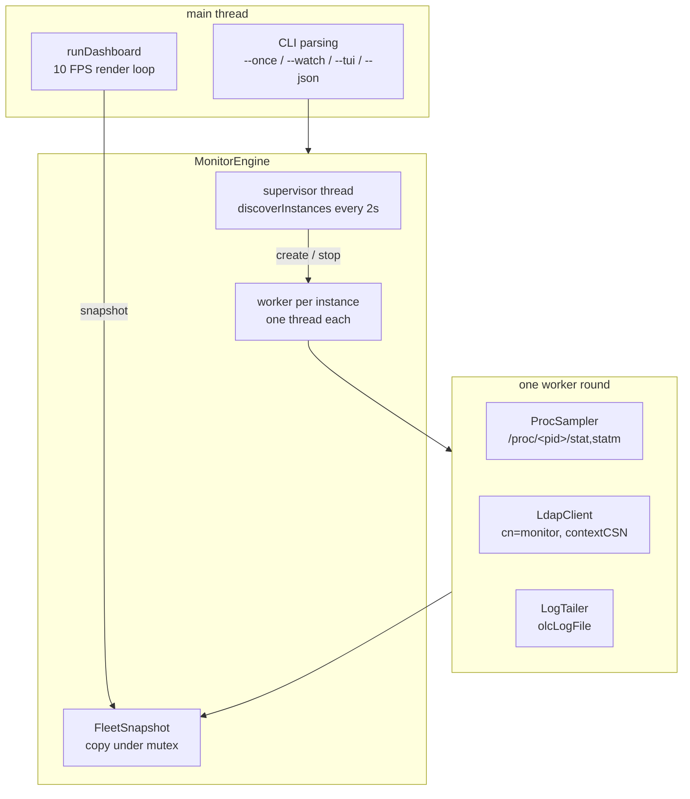
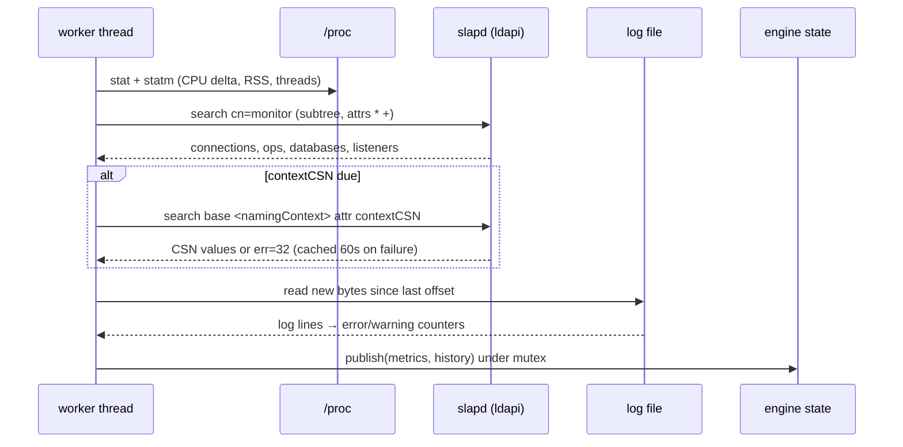

# Architecture

## Goals

* See, at a glance, whether each `slapd` instance is healthy.
* Watch the small number of signals that actually predict trouble:
  connections, operation rate, error rate, replication lag, memory growth.
* Never block: a slow or half-dead server must degrade its own card only.
* Stay cheap: the tool itself must not distort what it measures.

## Runtime topology

### Why one thread per instance

A slow backend can take seconds to answer `cn=monitor`. With a single
collection loop, every other instance would freeze for the same duration and
the dashboard would look dead. Per-instance workers isolate the failure: the
affected card shows `degraded` with the LDAP error, the rest keep updating.

The UI never waits for a worker: it copies `FleetSnapshot` under a mutex and
renders the copy. Copy cost is a few hundred doubles per instance.

## Collection round

## Data model

| Structure | Contents |
|---|---|
| `Instance` | name, `-F` directory, pid, listeners (from `/proc/<pid>/cmdline`) |
| `ProcSample` | utime/stime ticks, threads, RSS, VSZ, derived CPU % |
| `MonitorSnapshot` | connection counters, ops per type, databases, listeners, per-connection detail |
| `LogStats` | lines/s, errors/s, warnings, last error lines |
| `ReplicationInfo` | contextCSN values, newest CSN, lag against the fleet |
| `InstanceHistory` | five `Series<180>` for CPU, RSS, connections, ops/s, errors/s |

## Design decisions

### Anonymous bind first, SASL EXTERNAL on request

`cn=monitor` is readable by anonymous in a default deployment, and anonymous
needs no secrets on disk. Two libldap details cost real debugging time and are
worth remembering:

* passing `NULL` as the simple-bind credential yields `Protocol error`; a
  zero-length `berval` is required;
* `ldap_sasl_bind_s(..., "EXTERNAL", ...)` stops at
  `LDAP_SASL_BIND_IN_PROGRESS`; the interactive helper must drive the exchange.

### Log path without LDAP privileges

`olcLogFile` lives in `cn=config`, which anonymous cannot read. The worker
therefore falls back to parsing `<slapd -F dir>/cn=config.ldif` (or
`slapd.conf`), which is readable by the slapd owner. Both paths are tried, in
that order.

### Two cadences: process fast, LDAP slower

A full `cn=monitor` listing is ~87 entries and costs 3-5 % of one core when
read twice per second. Splitting the
narrow counters into six searches is *worse* (more round trips), so the
dashboard keeps one subtree search but reads it every 2 s by default, while
`/proc` keeps the 1 s cadence. Between two LDAP reads the previous answer is
reused, so the cards never go blank; measured cost drops to 0-1 %.

### Rates use their own sampling period

The operation rate must be divided by the time elapsed since the *previous
LDAP read*, not the `/proc` tick: with a 2 s LDAP period under a 0.5 s process
period, using the wrong denominator inflates the rate by 4x. The worker keeps
`lastLdapAt` next to `lastOps` for that reason.

### contextCSN is polled slowly
A naming context without a root entry answers `err=32` to a base search, and
that error lands in the monitored server's own log — the tool would measure its
own noise. Results are cached, re-queried every 5 s on success and every 60 s
on failure.

### The architecture is read from cn=config, on disk

`cn=config` is usually not readable over LDAP without credentials, while
slapd's own `-F` directory is readable by its owner. The collector parses the
LDIF tree directly, with three rules:

* **rotated copies are ignored**: `*.bak_*`, `*.orig` and `*~` next to the
  live tree would describe databases that no longer exist;
* **depth**: only the top-level database entries are read; an overlay subtree
  declares databases of its own and is not one;
* **path, not DN**: an overlay file belongs to the enclosing
  `olcDatabase={N}type/` directory, whatever its DN says.

Links are then matched by port: `olcDbURI`/`syncrepl provider=` gives
`host:port`, `cn=monitor` gives each instance's listeners, so a proxy edge
resolves to the instance that actually listens on that port. The correlation
panel shows both ends and their ratio (`x1.00` when the proxy forwards exactly
what it receives).

### cn=monitor

| Attribute | Meaning | Used how |
|---|---|---|
| `monitorConnectionAuthzDN` | DN actually authenticated on the connection | shown as **bind** in the connection list, no log digging |
| `monitorConnectionMask` | granted access mask (`r`, `rx`, ...) | shown next to the bind |
| `olmDbBoundDN` | DN the proxy bound with towards a backend | backend line of the detail view |
| `olcServerID` (cn=config) | SID → URL map of the replication topology | replication matrix: which instance owns which SID |
| `contextCSN` per SID | last write of each replica | replication view: last write, change time, worst lag |
| `monitorOpCompleted` per operation | replica activity | replication view: `Num` and `Num/s` per operation |
| `olmMDBEntries` | entries held by a database | replication view: size of the replicated context |

| `olmDbConnURI`, `olmDbConnPeerAddress`, `olmDbConnFlags` | backend target, peer, state (`tainted`) | backend line of the detail view |
| `monitorConnectionGet/Read/Write` | socket I/O call counts | I/O column |
| `pcacheNumQueries`, `pcacheNumEntries`, `pcacheQueryURL` | proxy cache counters | databases view / raw monitor view |
| `olmMDBEntries/Pages*/Readers*` | MDB occupancy | databases view |
| `monitorTimestamp` (cn=Time) | server start and current time | raw monitor view |
| `monitorCounter` (cn=Statistics, cn=Waiters) | bytes, PDUs, entries, waiters | raw monitor view |

Two protocol traps:

* `monitorConnectionNumber` is operational and **does not match in LDAP
  filters** — a `(monitorConnectionNumber=*)` search returns one entry instead
  of thousands. Select with `(cn=Connection*)` instead.
* RFC 2891 sort on `monitorConnectionOpsCompleted` returns
  `inappropriate matching` (18), which fails the *whole* search: sort locally.

### Text is segmented per UAX #29

notcurses renders grapheme clusters, so the code must measure and truncate on
the same boundaries. A per-codepoint split cuts `e` + U+0301 into two glyphs,
and a ZWJ emoji into its parts, shifting every following column.

`src/ui/text.cpp` uses libunistring (`uc_grapheme_breaks`, `uc_width`). One
caveat is handled explicitly: RHEL 9 ships libunistring 0.9.10 (Unicode 6.1),
whose `uc_width()` reports 1 for every pictograph. A table of East Asian
Wide/Fullwidth and Emoji_Presentation ranges corrects the measurement, so an
emoji occupies the two columns the terminal actually uses.

`ncplane_putnstr_yx` was not used for truncation: it stops on a byte count
(`size_t s` is bytes), which can overshoot a column budget.

### Graphs are drawn by hand, not with a widget library

notcurses 3.0 ships no `ncplot`, and `ncvisual_blit` with `NCBLIT_PIXEL` only
works when the terminal advertises a pixel protocol. `slaptop --probe-pixels` reports what
the terminal in front of the user supports (Konsole and foot implement sixel;
kitty/WezTerm/Ghostty implement kitty graphics; tmux only forwards sixel when
built with `--enable-sixel`). The ncvisual blitters were evaluated
(`NCBLIT_3x2`, `NCBLIT_4x2`, `NCBLIT_BRAILLE`): they cap at two colours per
cell, which is worse than the current vertical gradient, so the graphs are
drawn column by column: each cell is a block rune (`▁▂▃▄▅▆▇█`) chosen from the
sample level, giving 8 vertical steps per row, with a palette interpolated on
the vertical axis.

Two refinements use the library properly:

* **horizontal interpolation** — when the graph is wider than the series, the
  samples are linearly interpolated so the area fills the width instead of
  stopping mid-card;
* **native gradients** — `ncplane_gradient()` paints a subdued vertical
  gradient inside each card, so the body reads as one soft block.

Two scaling rules matter more than the drawing code:

* CPU and activity are zero-based (`0 .. max*1.08`) so a spike keeps its
  proportions;
* memory is also zero-based, but samples equal to zero are excluded from the
  window — the first rounds have no RSS data, and a zero in the window
  collapses every real value to the top of the graph.

### Runewidth-safe rendering

notcurses 3.0.14/3.0.17 (both the EPEL package and the Homebrew bottle) ship
only C headers: no `notcurses.hh`, no `ncplot.h`. Frames, cards and sparklines
are drawn with runes through the C API. Every string is truncated to the card's
inner width *before* being written, so a redraw at 40 columns cannot spill over
the border.

## Failure modes and behaviour

| Failure | Visible behaviour |
|---|---|
| slapd process exits | card turns red, state `stopped`, removed after the next supervisor pass |
| `cn=monitor` times out | state `degraded`, LDAP error shown, socket dropped and reconnected next round |
| `ldapi` socket missing/permission denied | state `degraded`, `bind: ...` message on the card |
| log file rotated/truncated | tailer detects inode change or shrink, re-opens at end |
| log file unreadable | log block hidden, process/LDAP metrics unaffected |
| no instance found | "no slapd instance found" (plain text) or empty dashboard |

## Test strategy

* `ctest` runs twelve dependency-free suites: `/proc` parsing, instance naming,
  log parsing and rotation, `cn=config` and `slapd.conf` reading, index
  coverage, behaviour windows, replication topology, SSH node specs.
* ThreadSanitizer and AddressSanitizer/UBSan: `--once` reports no data race,
  no leak and no undefined behaviour.

## Build matrix

| Context | notcurses | libldap headers |
|---|---|---|
| distribution packages | `pkg-config notcurses` | `pkg-config ldap` |
| headers built out of tree | `-DSLAPTOP_NOTCURSES_CORE_A` | `-DSLAPTOP_LDAP_ROOT`, `-DSLAPTOP_LDAP_LIBDIR` |

A runtime that ships `libldap.so.2` without an unversioned `.so` is accepted:
CMake links the versioned soname and sets an `RPATH` on its directory.
